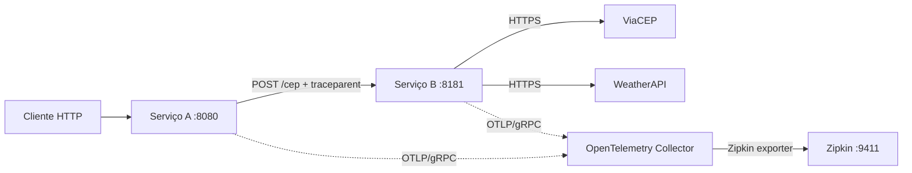
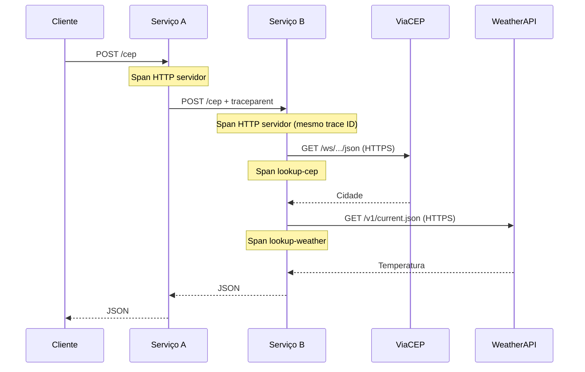

# Temperatura por CEP com OpenTelemetry

Exemplo em **Go** de comunicação entre dois serviços HTTP, consulta às APIs ViaCEP e WeatherAPI e rastreamento distribuído com **OpenTelemetry Collector + Zipkin**.

O projeto demonstra propagação do contexto W3C (`traceparent`), spans distribuídos e encerramento gracioso dos servidores. É um laboratório de integração e observabilidade; não é uma plataforma de produção.

## Executar com Docker Compose

Requisitos: Docker Engine com Docker Compose v2 e uma chave pessoal da [WeatherAPI](https://www.weatherapi.com/).

```bash
cp .env.example .env
# Substitua o valor de WEATHER_API_KEY em .env pela sua própria chave.
docker compose up --build -d
```

O Compose exige `WEATHER_API_KEY` definido. O arquivo `.env` é ignorado pelo Git; nunca inclua chaves reais no repositório.

Exemplo de requisição:

```bash
curl -X POST http://localhost:8080/cep \
  -H 'Content-Type: application/json' \
  -d '{"cep":"86027410"}'
```

Exemplo de formato da resposta (temperaturas dependem das condições reais):

```json
{
  "city": "Londrina",
  "temp_c": 25.2,
  "temp_f": 77.36,
  "temp_k": 298.35
}
```

Acesse a interface do Zipkin em **http://localhost:9411/zipkin/**. Pesquise os serviços `service-a` e `service-b` após enviar uma requisição. Exportação de spans é assíncrona e pode levar alguns segundos.

Para desligar:

```bash
docker compose down
```

## Fluxo da arquitetura



O Serviço A recebe o CEP, valida seu formato e encaminha a requisição ao Serviço B. O Serviço B consulta o endereço do CEP, busca a temperatura da cidade e converte Celsius para Fahrenheit e Kelvin. Os dois serviços exportam spans para o Collector, que os encaminha ao Zipkin.

### Tracing distribuído



- Os middlewares `otelhttp.NewHandler` criam spans de entrada nos serviços.
- O transporte HTTP do Serviço A utiliza `otelhttp.NewTransport`, criando um span cliente e propagando `traceparent`.
- O Serviço B continua o contexto recebido e cria spans internos para consulta ao CEP e ao clima.
- As chamadas externas usam HTTPS, verificam certificados e possuem timeout. **A chave da WeatherAPI não deve ser registrada como atributo de tracing.**

O endereço do Collector é configurado por `OTEL_COLLECTOR_ENDPOINT` (no Compose: `otel-collector:4317`; fora dele, padrão `localhost:4317`). O exportador OTLP/gRPC utiliza conexão sem TLS apenas **dentro da rede local de desenvolvimento**; para implantação externa, habilite TLS/autenticação.

## Resiliência e execução

- Os servidores escutam nas portas definidas por `HTTP_PORT` e usam `http.Server.Shutdown` com prazo de 10 segundos ao receber SIGTERM/SIGINT.
- O provedor OpenTelemetry é encerrado com contexto próprio para tentar descarregar spans pendentes.
- As requisições de saída têm timeout de 15 segundos e respeitam o contexto recebido.
- O Compose publica somente o Serviço A e o Zipkin, vinculados a `127.0.0.1`. O Serviço B e o Collector permanecem internos.
- O exemplo não inclui retries, circuit breaker, fila persistente de spans, autenticação entre serviços ou readiness checks; essas seriam melhorias para um ambiente produtivo.

## Desenvolvimento e testes

```bash
go test -race ./...
go vet ./...
gofmt -l internal
```

O GitHub Actions também executa o build dos dois serviços e verifica a sintaxe do Docker Compose. Testes locais verificam cabeçalhos W3C, continuidade do trace ID, cancelamento e parada do servidor.

## Notas técnicas

As versões do Collector e Zipkin estão fixadas no Compose, evitando mudanças inesperadas ao recriar os contêineres. O projeto ainda usa versões de dependências Go declaradas em `go.mod` e requer revisão periódica de atualizações e vulnerabilidades.

O exportador Zipkin do Collector é adequado para este laboratório. Para evoluções futuras, considere avaliar ingestão OTLP direta no backend de observabilidade.

## Licença

Veja [LICENSE](LICENSE).
