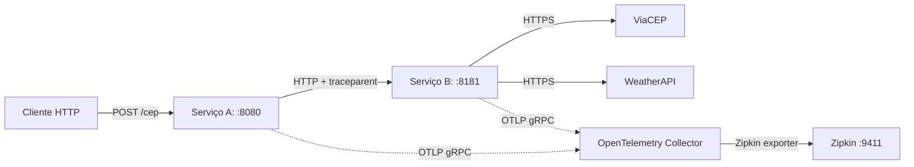
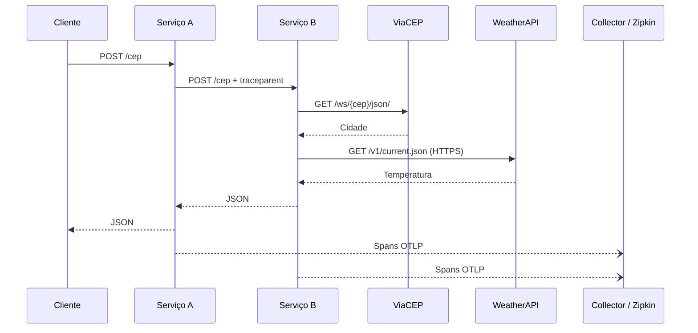

# Temperatura por CEP com observabilidade

Exemplo de **dois serviços Go** que recebem um CEP brasileiro, consultam a localidade no ViaCEP e recuperam a temperatura na WeatherAPI. A instrumentação utiliza **OpenTelemetry**, **OTLP gRPC**, **OpenTelemetry Collector** e **Zipkin**.

É uma demonstração de comunicação HTTP síncrona entre serviços, propagação de contexto e observabilidade; não é um ambiente pronto para produção.

## Arquitetura



O Serviço A recebe a requisição e a encaminha ao Serviço B. O Serviço B verifica o CEP, resolve a cidade pelo ViaCEP e consulta a WeatherAPI. Os spans de entrada usam `otelhttp.NewHandler`, e a chamada A → B usa `otelhttp.NewTransport`, que injeta automaticamente o contexto de tracing HTTP. O Serviço B instrumenta as operações `Busca_CEP` e `Busca_Temperatura`.

**Observação de segurança:** a WeatherAPI utiliza uma chave de API na query string. Para não registrar essa chave nos atributos de URL dos spans, a instrumentação automática de cliente HTTP exclui esse host. O span manual `Busca_Temperatura` continua representando a operação, mas não existe um span HTTP automático adicional para a WeatherAPI.

## Executar com Docker Compose

Pré-requisitos: Docker com plugin Compose, conexão de internet e uma chave da [WeatherAPI](https://www.weatherapi.com/).

```bash
cp .env.example .env
# Edite .env e configure WEATHER_API_KEY com a sua chave real.
docker compose up --build -d
```

O Compose exige a variável `WEATHER_API_KEY`; não é necessário editar o `docker-compose.yml`. O arquivo `.env` é ignorado pelo Git e nunca deve ser publicado.

Faça uma requisição:

```bash
curl -i -X POST http://localhost:8080/cep \
  -H 'Content-Type: application/json' \
  -d '{"cep":"01001000"}'
```

Exemplo ilustrativo do formato da resposta (valores meteorológicos variam):

```json
{
  "city": "São Paulo",
  "temp_c": 25,
  "temp_f": 77,
  "temp_k": 298.15
}
```

Depois de enviar a requisição, abra o painel do Zipkin em **http://localhost:9411/zipkin/** e procure por traces de `service-a` ou `service-b`. A exportação de spans é assíncrona: pode haver um pequeno intervalo antes da visualização.

Para encerrar:

```bash
docker compose down
```

## Tracing distribuído



Os contextos dos clientes HTTP usam `r.Context()`; se a requisição original for cancelada, o cancelamento também alcança as consultas externas. As chamadas HTTP têm timeout de 15 segundos. O encerramento dos dois serviços captura `SIGINT` e `SIGTERM`, aguarda até 10 segundos pelo fechamento das conexões e faz flush do provedor de tracing.

O Collector usa uma configuração explícita com receiver OTLP gRPC, processador batch e exporter Zipkin. A comunicação interna com o Collector utiliza gRPC sem TLS **somente na rede privada da demonstração local**; em ambiente não confiável, configure transporte seguro.

## Testes e qualidade

```bash
go test -race ./...
go vet ./...
```

O workflow do GitHub Actions verifica formatação Go, testes com detector de concorrência, compilação dos dois serviços e `go vet`. Os testes usam respostas HTTP simuladas e não exigem chaves reais.

## Limitações e próximos passos

- Este exemplo não implementa autenticação ou controle de taxa.
- O Serviço A faz validação superficial do tamanho do CEP; a validação dos oito dígitos ocorre no Serviço B.
- Falhas externas retornam erros controlados (por exemplo, HTTP 502). Não há retries com backoff nem circuit breaker.
- O Zipkin e o Collector não constituem observabilidade completa de produção: métricas, logs estruturados e alertas são evoluções possíveis.
- URLs externas que contenham credenciais não devem ser enviadas integralmente aos sistemas de tracing.

## Referências

- [OpenTelemetry Go](https://opentelemetry.io/docs/languages/go/)
- [OpenTelemetry Collector](https://opentelemetry.io/docs/collector/)
- [Zipkin](https://zipkin.io/)
